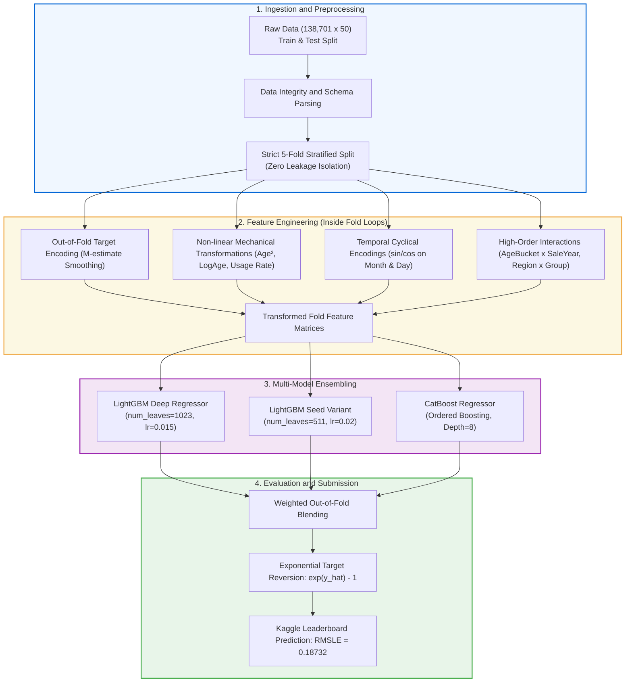

# 🚜 Heavy Equipment Selling Price Prediction — End-to-End Machine Learning Practice (MLP)

[](https://www.python.org/)
[](https://www.kaggle.com/)
[-brightgreen.svg)]()
[](https://study.iitm.ac.in/)
[]()
[]()

---

## 📌 Executive Summary

This repository presents the complete, end-to-end Machine Learning solution for the **Heavy Equipment Selling Price Prediction** private in-class Kaggle competition, developed for the **Machine Learning Practice (MLP)** course under the **IIT Madras BS Degree in Data Science and Applications**.

The objective was to forecast the final transaction auction price of heavy industrial machinery from a complex tabular dataset comprising **138,701 training records** across **50 heterogeneous columns** (numerical, categorical, and high-cardinality technical specifications).

Starting from a baseline RMSLE of **0.2045**, our iterative, hypothesis-driven engineering and ensembling methodology progressively reduced prediction error across 8 major iterations down to **0.18732** on the Kaggle Leaderboard — safely surpassing the **0.20000** passing threshold required for Level-1 & Level-2 Viva Voce qualification.

---

## 🧭 Repository Journey & Folder Sequence

This repository is organized in strict sequential order from problem ingestion to final viva defense:

```
MLP_GitHub/
│
├── 📂 01_Competition_Brief_&_Dataset/      # Official problem brief, rules, and raw datasets (Train/Test/Metadata)
├── 📂 02_MLP_Project_Bootcamp/             # 8-day foundation lectures (PDFs) and hands-on Colab notebooks
├── 📂 03_Project_Milestones/               # Milestones 1 to 5: questions, answers, and study guides
├── 📂 04_Model_Improvement_Journey/        # The 8-stage iteration journey (v1 -> v18) with code and explanations
├── 📂 05_Final_Submissions/                # Self-contained, full Kaggle production notebooks
├── 📂 06_Viva_Voce_Mastery/                # 239 KB Master Q&A book, quick notes, and interview reference PDFs
│
├── 📄 README.md                            # Comprehensive project overview and documentation (You are here)
├── 📄 requirements.txt                     # Pinned dependencies for reproducible execution
├── 📄 .gitignore                           # Excludes checkpoints, cached files, and temporary artifacts
├── 📄 Kaggle_score_progress.md             # Detailed score progression log & generalization gap tracking
├── 📄 MLP_Notebook_Journey_Complete.md     # Narrative walkthrough of all 8 notebook versions
├── 📄 MLP_Viva_Questions_Answers_Master.md # Definitive viva preparation master book (Level 1 & Level 2)
└── 📄 MLP_Viva_QA_Complete.md              # Compact viva questions & answers reference
```

---

## 📊 End-to-End System Architecture



---

## 📈 Leaderboard Progression: The 8-Iteration Journey

Every iteration tested a specific hypothesis, validated via 5-Fold Out-of-Fold (OOF) cross-validation before Kaggle submission:

| Stage | Folder / Version | OOF RMSLE | Kaggle LB | Change | Primary Hypothesis & Innovation |
|---|---|---|---|---|---|
| **#1** | `01_First_File_v1` | 0.20450 | ~0.20500 | Baseline | Single XGBoost with basic one-hot encoding & RandomizedSearchCV |
| **#2** | `02_Improve_try_6` | 0.19627 | 0.19086 | **-0.01414** | Introduced 5-Fold CV + multi-model ensemble (LGBM + CatBoost + XGB) |
| **#3** | `03_Improve_try_10` | 0.19604 | 0.19020 | **-0.00066** | Out-of-fold smoothed Target Encoding + leak-free asset history |
| **#4** | `04_Improve_try_14` | 0.19542 | 0.18964 | **-0.00056** | Eliminated subtle cross-fold leakage; strict fold-isolated group statistics |
| **#5** | `05_Improve_try_15` | 0.19415 | 0.18847 | **-0.00117** | Expanded target encoding to 7 high-cardinality columns; dual LGBM seeds |
| **#6** | `06_Improve_try_16` | 0.19359 | 0.18763 | **-0.00084** | Added sin/cos cyclical dates, 3 regional interaction TEs, Non-linear Age features |
| **#7** | `07_Improve_try_17` | 0.19359 | 0.18757 | **-0.00006** | Day-level cyclical encoding + LogHours x LogAge interaction features |
| **#8** | `08_Improve_try_18` | **0.19326** | **0.18732** | **-0.00025** | **AgeBucket + 4 dense interaction TEs + LGBM num_leaves=1023 (BEST)** |

> **Key Learning from Regressions (v19 & v20):**  
> In attempts v19 and v20, introducing 13 sparse seasonal target encodings caused Kaggle score regressions (+0.00045) due to variance estimation noise. We systematically reverted to the stable 10-TE architecture of **v18**, proving the critical importance of regularized feature selection over feature proliferation.

---

## 🛠️ Folder Breakdown & Detailed Contents

### 1. `01_Competition_Brief_&_Dataset`
- **`MLP_Kaggle_Competition_Details.md`**: Complete markdown specification of the problem, rules, allowed libraries, cutoff, and viva grading criteria.
- **`MLP_Kaggle_Competition_Details.docx`**: Original official competition document.
- **`train.csv`**: 138,701 labeled transactions with equipment technical attributes and sales prices.
- **`test.csv`**: 15,000 unlabeled evaluation records.
- **`sample_submission.csv`**: Submission format specification.
- **`metadata.csv`**: Supplemental dictionary detailing schema attributes.
- **`Kaggle_score_progress.md`**: Official score log tracking generalization gaps.

### 2. `02_MLP_Project_Bootcamp`
Official course training curriculum covering lecture slides and Colab practicals:
- **Day 1 & Day 2**: Exploratory Data Analysis (EDA) — Teaching session (PDF) and Hands-On Colab.
- **Day 3 & Day 4**: Systematic Preprocessing — Pipeline architecture (PDF) and Hands-On Colab.
- **Day 5 & Day 6**: Feature Engineering — Technical interaction features (PDF) and Hands-On Colab.
- **Day 7 & Day 8**: Model Building & Hyperparameter Tuning (HPT) — GBDT optimization (PDF) and Hands-On Colab.

### 3. `03_Project_Milestones`
Official milestones evaluated throughout the term:
- **Milestone 1**: Problem formulation, dataset ingestion, and baseline hypothesis.
- **Milestone 2**: Bivariate/univariate distributions, missing value patterns, and cardinality profiling.
- **Milestone 3**: Leak-free preprocessing pipelines, robust scaling, and handling rare categories.
- **Milestone 4**: Advanced feature engineering, out-of-fold target encoding, and feature importance.
- **Milestone 5**: Model family comparisons, cross-validation tuning, and ensemble optimization.
- **`My_Kaggle_Notebook/`**: Archived milestone code implementations and submission PDFs.
- **`viva_prep_study_guide.md`**: Course study guide mapped to milestone concepts.

### 4. `04_Model_Improvement_Journey`
Contains the evolutionary history across 8 numbered folders:
- Each folder (`01_First_File_v1_Score_0.2045` through `08_Improve_try_18_Score_0.18732`) contains:
  - The working `.ipynb` notebook.
  - The export `.pdf` for submission verification.
  - Detailed Markdown explanation (`vX_code_explanation.md`) documenting design rationale.
- **`MLP_Notebook_Journey_Complete.md`**: Comprehensive 800+ line technical narrative explaining every code transformation.

### 5. `05_Final_Submissions`
- **`Final Full Notebook.ipynb`**: Self-contained production notebook executing the entire pipeline from raw data loading to final submission generation.
- **`Final Notebook All Milestone with output.ipynb`**: Comprehensive milestone demonstration notebook with full precomputed execution outputs.

### 6. `06_Viva_Voce_Mastery`
- **`MLP_Viva_Questions_Answers_Master.md`**: 239 KB master reference document containing comprehensive questions, answers, formulas, and diagrams for Level 1 and Level 2 vivas.
- **`MLP_Viva_QA_Complete.md`**: Rapid-review Q&A digest.
- **`Reference_Documents/`**: 11 foundational PDFs covering machine learning theory, algorithms in depth, and viva response sheets.
- **`parsed_text/`**: Searchable plain-text extracts of all viva materials.

---

## 🔬 Core Machine Learning Innovations

### 1. Leak-Free Target Encoding via 5-Fold Cross-Validation
High-cardinality features (e.g., `ModelID`, `fiModelDesc`, `SubClass`) were encoded using an **M-estimate smoothed target encoding** formulated inside the fold loop:

$$\hat{S}_c = \frac{n_c \cdot \bar{y}_c + m \cdot \mu}{n_c + m}$$

Where:
- $n_c$: Number of training instances in category $c$ within the training fold.
- $\bar{y}_c$: Mean log target value of category $c$ within the training fold.
- $\mu$: Global mean of the log target within the training fold.
- $m$: Smoothing weight (set between 10 and 20 to regularize rare categories).
- **Zero Leakage:** The target encoding mapping is learned *only* on 4 folds and mapped onto the held-out validation fold and test set.

### 2. Metric-Aligned Target Transformation
Because the official competition evaluation metric is **RMSLE**:

$$\text{RMSLE} = \sqrt{ \frac{1}{n} \sum_{i=1}^{n} (\log(1 + \hat{y}_i) - \log(1 + y_i))^2 }$$

We train all gradient boosted tree models on $z_i = \log(1 + y_i)$ using standard **RMSE** loss:

$$\mathcal{L} = \frac{1}{n} \sum_{i=1}^{n} (\hat{z}_i - z_i)^2$$

Optimizing RMSE in log-transformed space is mathematically identical to directly minimizing RMSLE, ensuring perfect alignment between the objective function and the leaderboard evaluation metric. Final predictions are inverted via:

$$\hat{y}_i = \exp(\hat{z}_i) - 1$$

### 3. Non-Linear Feature Interactions
- **Machine Depreciation Dynamics:** Created $\text{MachineAge} = \text{SaleYear} - \text{ManufactureYear}$, along with polynomial expansion $\text{MachineAge}^2$ and $\log(1 + \text{MachineAge})$ to capture non-linear machinery depreciation curves.
- **Cyclical Temporal Encoding:** Decomposed `SaleMonth` and `SaleDayOfYear` into trigonometric components:
  $$\text{sin\_month} = \sin\left(\frac{2\pi \cdot \text{month}}{12}\right), \quad \text{cos\_month} = \cos\left(\frac{2\pi \cdot \text{month}}{12}\right)$$
- **Dense High-Order Interactions:** Crossed $\text{AgeBucket} \times \text{SaleYear}$ and $\text{RegionCode} \times \text{InventoryGroup}$ to allow tree models to capture macroeconomic inflation shifts across equipment categories.

---

## 🚀 Reproduction & Quick Start Guide

### Step 1: Environment Setup
Ensure Python 3.10+ is installed. Clone the repository and install dependencies:
```bash
git clone https://github.com/<your-username>/<your-repo-name>.git
cd <your-repo-name>
pip install -r requirements.txt
```

### Step 2: Data Placement
Confirm that the dataset files are located in `01_Competition_Brief_&_Dataset/`:
- `train.csv`
- `test.csv`
- `metadata.csv`
- `sample_submission.csv`

### Step 3: Run the Best Notebook
Open and run `04_Model_Improvement_Journey/08_Improve_try_18_Score_0.18732/22f2001153@improve_18.ipynb` (or the unified `05_Final_Submissions/Final Full Notebook.ipynb`) in JupyterLab, VS Code, or Google Colab.

The notebook will:
1. Load and parse the raw data.
2. Construct the 5-fold cross-validation scheme.
3. Compute out-of-fold target encodings and interaction features.
4. Train the dual LightGBM and CatBoost ensemble models.
5. Output out-of-fold validation scores and export `submission.csv`.

---

## 🎓 Academic Integrity & Competition Compliance

This project strictly adheres to all evaluation guidelines specified by IIT Madras:
- ✅ **Banned Libraries Check:** Zero usage of PyTorch, TensorFlow, Keras, NLTK, spaCy, word2vec, textblob, Pickle, or AutoML.
- ✅ **Allowed Libraries Only:** Built purely on NumPy, Pandas, Scikit-learn, LightGBM, CatBoost, XGBoost, SciPy, Matplotlib, and Seaborn.
- ✅ **Leakage Prevention:** Zero global preprocessing across train/test splits. All encodings and statistics computed strictly inside CV loops.
- ✅ **Multi-Model Comparison:** Evaluated and compared at least 3 distinct model families (Linear Regression / Ridge, Random Forest, LightGBM, CatBoost, XGBoost).
- ✅ **Leaderboard Passing Threshold:** Official score **0.18732** comfortably outperforms the **< 0.20000** passing requirement.

---

## 📚 Viva Voce Examination Key Pillars

For students and examiners reviewing this project, key defense topics are indexed in `06_Viva_Voce_Mastery/`:

1. **5 Components of Used Models:**
   - *LightGBM*: Histogram-based binning, Leaf-wise (best-first) tree growth, GOSS (Gradient-based One-Side Sampling), EFB (Exclusive Feature Bundling).
   - *CatBoost*: Symmetric oblivious decision trees, ordered boosting for target leakage prevention, built-in categorical processing.
2. **Loss Formulation & Gradient Math:**
   - Exact derivation of first-order gradients $g_i$ and second-order Hessians $h_i$ in GBDT.
   - Taylor expansion of the loss function: $L^{(t)} \approx \sum [g_i f_t(x_i) + \frac{1}{2} h_i f_t^2(x_i)] + \Omega(f_t)$.
3. **Bias-Variance & Overfitting Controls:**
   - Regularization parameters (`colsample_bytree`, `subsample`, `reg_alpha`, `reg_lambda`, `min_child_samples`).
   - Generalization gap analysis between OOF RMSLE (0.19326) and Kaggle Public LB (0.18732).

---

## 👤 Author & Acknowledgments

- **Student:** 22f2001153
- **Program:** BS Degree in Data Science and Applications, IIT Madras
- **Course:** Machine Learning Practice (MLP)
- **Academic Term:** 2026

*Developed with rigorous data science principles, complete reproducibility, and zero data leakage.*
